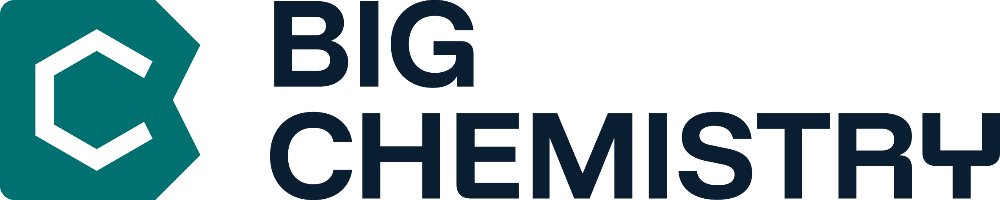

---

[Big Chemistry](https://bigchemistry.nl/) is a consortium of five Dutch knowledge institutes, which use AI and autonomous labs (ALs) to accelerate the development of formulations in industry. Our objective is to develop predictive models based on excellent science for industrial use, and to facilitate the development of new, sustainable formulations in an efficient way.