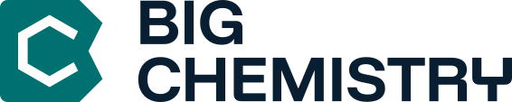
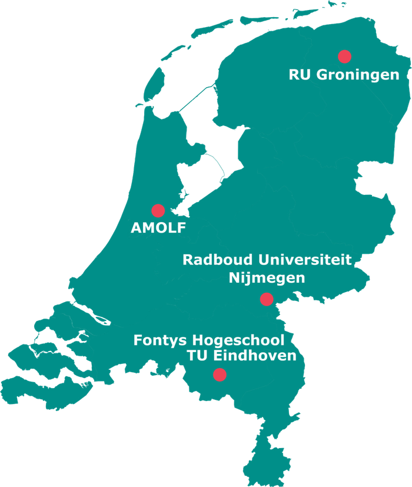

  <a href="https://bigchemistry.nl/">
    <picture>
      <source media="(prefers-color-scheme: dark)" srcset="./BC_primair_logo_horiz_diapos_rgb.svg">
      <source media="(prefers-color-scheme: light)" srcset="./BC_primair_logo_horiz_rgb.svg">
      
    </picture>
  </a>

  <b>Making formulation a data-driven science, using AI-guided autonomous labs.</b>

## About us

[Big Chemistry](https://bigchemistry.nl/) is a consortium of five Dutch knowledge institutes. We want formulation chemistry to rely on data rather than trial and error. To do that, we build **AI-guided autonomous labs (ALs)** and **databases of complex molecules**. With these we develop predictive models, grounded in excellent science, for use in industry. The goal is to design new, sustainable formulations quickly and efficiently.

**Partner institutes:**

- Eindhoven University of Technology (TU/e)
- Radboud University, Nijmegen
- University of Groningen
- AMOLF, Amsterdam
- Fontys University of Applied Sciences, Eindhoven

 

## What we work on

| Research line | Description |
|---|---|
| 🤖 **[Autonomous Labs](https://bigchemistry.nl/autonomous-labs/)** | High-throughput experimental platforms that automatically collect the high-quality data AI models need. |
| 📊 **[Data](https://bigchemistry.nl/data/)** | Formulation knowledge, including physicochemical property data, gathered from autonomous experiments and literature mining. |
| 🧪 **[ALs for formulation research](https://bigchemistry.nl/autonomous-labs-at-big-chemistry/)** | Autonomous labs applied to real formulation problems. |

### Our autonomous labs

Six autonomous labs are currently operational. Each one targets a key property of formulations:

| Lab | What it measures | Publication |
|---|---|---|
| 💧 **Pendant Drop** | Surface tension of single and binary surfactant systems. An autonomous robotic module uses active learning to map surfactant isotherms and find the critical micelle concentration and the maximum surface excess concentration. | <ul><li>[Dankloff *et al.*, *npj Comput. Mater.* **11**, 358 (2025)](https://www.nature.com/articles/s41524-025-01842-9)</li></ul> |
| ⚖️ **Hydrophilic Lipophilic Difference** | Interfacial tension, used to characterise emulsions. | — |
| 🔬 **Formulon** (µL) | Phase diagrams at the microlitre scale. Active machine learning automatically navigates phase behaviour, for example of condensates. | <ul><li>[Leurs *et al.*, *Nat. Commun.* **16**, 9598 (2025)](https://www.nature.com/articles/s41467-025-64617-2)</li></ul> |
| 🔬 **PhaseXplorer** (nL) | Phase diagrams at the nanolitre scale. Closed-loop active learning maps high-dimensional phase diagrams, and transfer learning reuses knowledge from earlier maps. | <ul><li>[Jansen *et al.*, *ACS Nano* **19**, 38981 (2025)](https://pubs.acs.org/doi/10.1021/acsnano.5c07268)</li><li>[González-García *et al.*, *npj Comput. Mater.* **12**, 279 (2026)](https://www.nature.com/articles/s41524-026-02154-2)</li></ul> |
| 🫧 **Foamatron** | Foam characteristics, and how well defoamers and anti-foam agents work. | — |
| 🎨 **Coatmat** | Coating properties, both in the liquid formulation and after curing. | — |

More details are on the [Big Chemistry website](https://bigchemistry.nl/autonomous-labs-at-big-chemistry/).

## Our goals

- **Scientific disruption:** we combine world-class chemistry expertise with AI-driven autonomous labs and a database of molecular properties.
- **Responsible innovation:** we share expertise, materials and technologies with industry partners, and with society.
- **Talent development:** we train the next generation in AI and engineering for accelerated chemical formulation.
- **Ecosystem building:** we connect start-ups and established players to speed up the design and commercialisation of ALs and AI algorithms.

## On GitHub

This organization hosts code from the Big Chemistry **Robot Lab**. You'll find software for lab automation, data pipelines and machine learning models for formulation research. See the repositories below.

